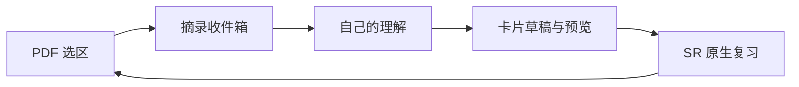
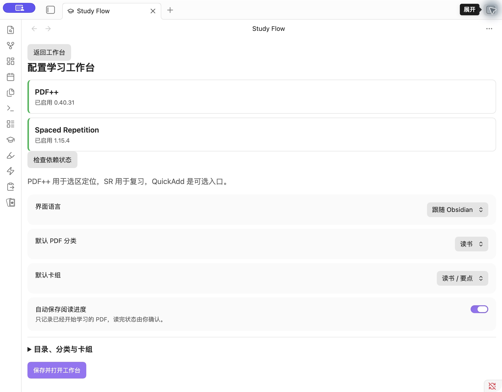
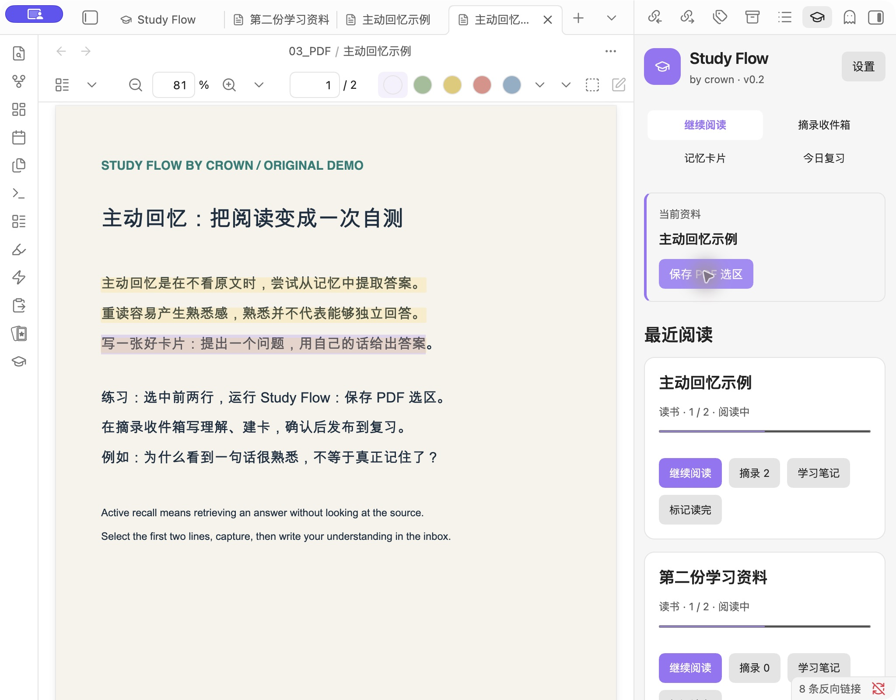
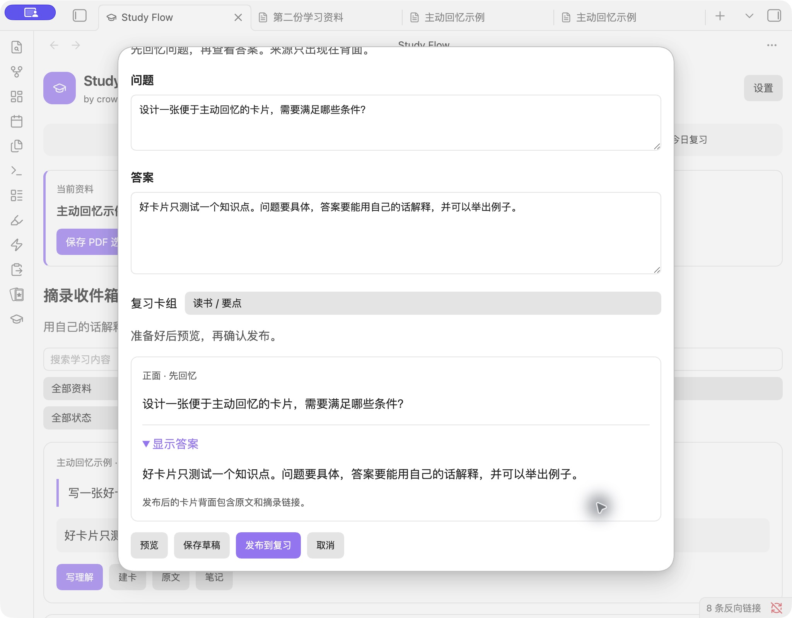
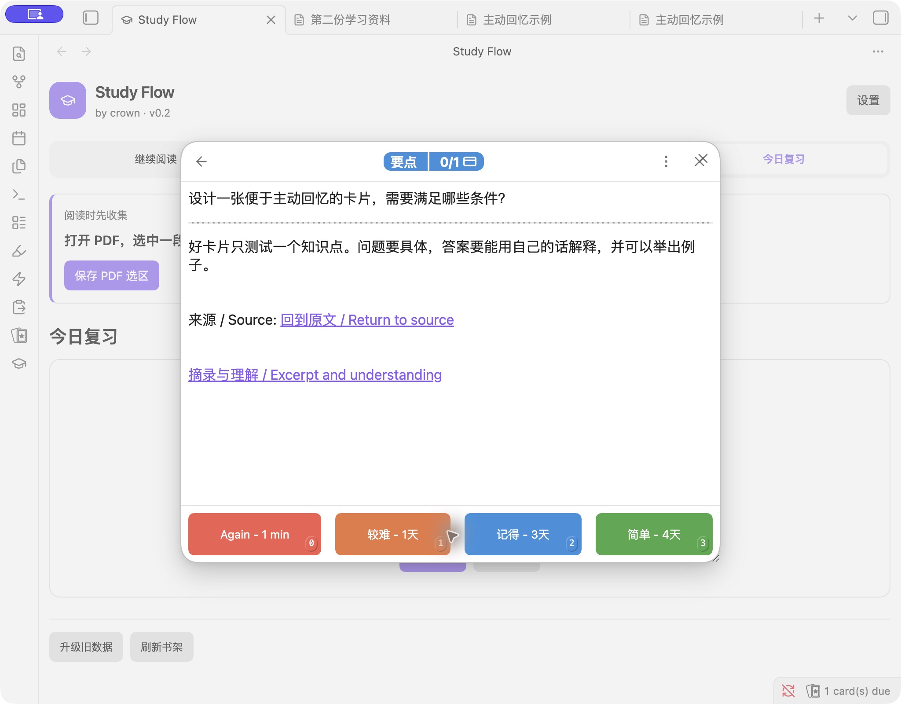

# Obsidian Study Flow · by crown

**阅读 PDF → 一键摘录 → 写下理解 → 制卡 → 间隔复习 → 返回原文。**

[English](README.en.md) · [原生插件上手](docs/native-guide.md) · [下载安装包](https://github.com/crown-sports/obsidian-study-flow/releases/tag/v0.2.0) · [价值与实现证据](docs/product.md)

适合在 Obsidian 读教材、论文或工作资料，划了很多重点却没有回头复习的人。
阅读时先保存原文，整理时写自己的理解，再把值得记住的问题发布到复习。你会留下可编辑的摘录和卡片，并能从答案返回 PDF 来源；界面支持中文和英文。



## 先选对安装包

从 [v0.2.0 发布页](https://github.com/crown-sports/obsidian-study-flow/releases/tag/v0.2.0)下载对应 ZIP 和 `SHA256SUMS`；[教程](docs/native-guide.md)说明如何核对。

| 你的情况 | 选择 |
| --- | --- |
| 第一次试用，先不动自己的笔记库 | **`obsidian-study-flow-example-v0.2.0.zip`**：新练习库，含插件和原创 PDF |
| 想装进已有笔记库 | **`obsidian-study-flow-plugin-v0.2.0.zip`**：把 `study-flow` 文件夹放进库内 `.obsidian/plugins/` |
| 继续使用旧 QuickAdd 宏 | `obsidian-study-flow-starter-v0.2.0.zip`：旧流程示例；新用户用上面两项 |

GitHub 自动提供的 “Source code” 是开发源码，不是可直接启用的插件包。当前尚未上架社区市场；PDF++ 和 Spaced Repetition 需要另外从社区安装。

## 用示例完成第一轮学习

1. 从 [v0.2.0 发布页](https://github.com/crown-sports/obsidian-study-flow/releases/tag/v0.2.0) 下载 `obsidian-study-flow-example-v0.2.0.zip` 和 `SHA256SUMS`，核对 SHA-256 后解压。
2. 将 `Study-Flow-Example` 作为 Obsidian 新库打开，启用 **Study Flow**。
3. 从社区市场安装并启用 **PDF++**、**Spaced Repetition**。工作台显示依赖状态，并提供安装入口。
4. 点击 🎓，保存默认配置。打开 `03_PDF/主动回忆示例.pdf`，选中第一页前两行，运行 **Study Flow: 保存 PDF 选区**。
5. 打开“摘录收件箱”写理解，例如“看着熟悉，不等于能独立回答”。创建问题“为什么重读不等于记住？”，用自己的话填写答案；保存草稿、预览，再发布。
6. 在“今日复习”开始复习，先回答，再显示答案和评分。点击答案里的来源链接返回 PDF。

**完成标志：**收件箱里有一条原文和理解，卡片进入复习，来源链接可返回阅读位置。草稿不会进入复习；若卡片没出现，先确认已发布、SR 已启用且所选卡组包含它。示例库也有同样的 `00_开始.md`，可以边看边做。

普通用户无需 Node、JSON 配置或 API Key。已有库安装只需把插件 ZIP 中的 `study-flow` 文件夹放进 `.obsidian/plugins/`；具体步骤见 [中英文教程](docs/native-guide.md)。第三方插件由用户自行安装，安装包不包含它们的二进制。



## 阅读与整理可以分开

| 场景 | 行为 |
| --- | --- |
| 阅读中发现重点 | 立即快照真实 PDF 选区，直接保存，无需先写小结；相同原文重复摘录返回已有文件 |
| 整理积累的摘录 | 按资料、分类、状态筛选，写理解，一条摘录可以建立多张卡片 |
| 还没想好问题 | 保存草稿；草稿不会被 SR 识别为复习卡 |
| 发布与复习 | 校验问题和答案，预览后发布；使用 SR 原生评分与调度 |
| 修改已复习卡片 | 原位编辑问题、答案、卡组，保留路径、ID 和 SM-2 / FSRS 调度注释 |
| 继续阅读 | 自动记录已开始学习的 PDF 页码，切换时刷新；读完状态由你确认 |
| 核对原文 | 背面提供选区、页码与摘录链接；PDF 缺失时仍可查看原文快照并重新关联 |
| 截图、复制、旧宏 | 保留原有入口，增加原生预览与保存；取消不写文件，失败清理新附件 |







## 已有记录如何继续用

已有 v0.2 预览插件：先备份库，关闭 Obsidian，用新版插件文件替换旧文件，保留 `data.json`；重新打开后重建学习索引。新版保存过的记录不要交给旧预览插件继续编辑。

旧 QuickAdd 学习笔记与卡片：从工作台“升级旧数据”先预览，确认“备份并升级”后才写入。原文件和复习调度保留；恢复前会检查之后的新编辑。具体步骤见[原生指南](docs/native-guide.md)。先在副本中确认自己的卡片和来源，再继续使用。

## 本地文件，组合已有能力

| 组件 | 职责 |
| --- | --- |
| Study Flow | 工作台、采集、理解、草稿与发布、Markdown 存储、索引、迁移与恢复 |
| [PDF++](https://github.com/RyotaUshio/obsidian-pdf-plus) | PDF 选区与定位 |
| [Spaced Repetition](https://github.com/st3v3nmw/obsidian-spaced-repetition) | 卡片解析、原生复习与调度 |
| [QuickAdd](https://github.com/chhoumann/quickadd)（可选） | 保留旧宏，启用原生插件时通过 `api.v1` 转接 |

现有技术价值是把采集、草稿、发布、编辑和恢复连接起来，同时保留原文与复习记录。
[代码与回归测试](docs/product.md)覆盖文本往返、调度保留、重复采集和升级冲突；这些是已实现行为，不是学习效果证明。

Markdown 是数据来源；索引可重建，配置通过界面管理。旧数据升级先预览并备份，恢复前检查后续编辑和复习冲突。本项目不修改第三方插件设置。v0.2 不包含 OCR、AI 制卡或图像遮挡。

真实应用验收使用 macOS / Obsidian 1.13.7 / PDF++ 0.40.31 / SR 1.15.4；Windows、Linux 的构建与文件验证由 CI 执行，应用操作尚未验收。手机端通过同步 Markdown 和附件使用 SR 复习。详见 [验证记录](docs/validation-v0.2.md) 与 [兼容范围](docs/compatibility.md)。

## 开发与参与

需要 Node 20+：

```sh
npm ci
npm run check
npm test
npm run package
```

`dist/` 生成原生插件、原生示例库、旧 QuickAdd 示例库三个 ZIP 与 `SHA256SUMS`。源码在 `src/`；旧脚本路径 `StudyFlow/scripts/` 保持稳定。

- [项目架构、数据格式与 API](docs/architecture.md)
- [原生插件中文教程](docs/native-guide.md) · [English tutorial](docs/native-guide.en.md)
- [旧 QuickAdd 图文教程](docs/guide.md) · [旧安装与恢复](docs/install.md)
- [贡献指南](CONTRIBUTING.md) · [MIT](LICENSE) · [上游致谢](NOTICE)
- [可选 Web Clipper 模板](web-clipper/README.md)

欢迎真实使用反馈、Issue、PR、翻译与兼容性测试。示例和截图仅使用原创练习资料，没有个人库内容或收费教材。
